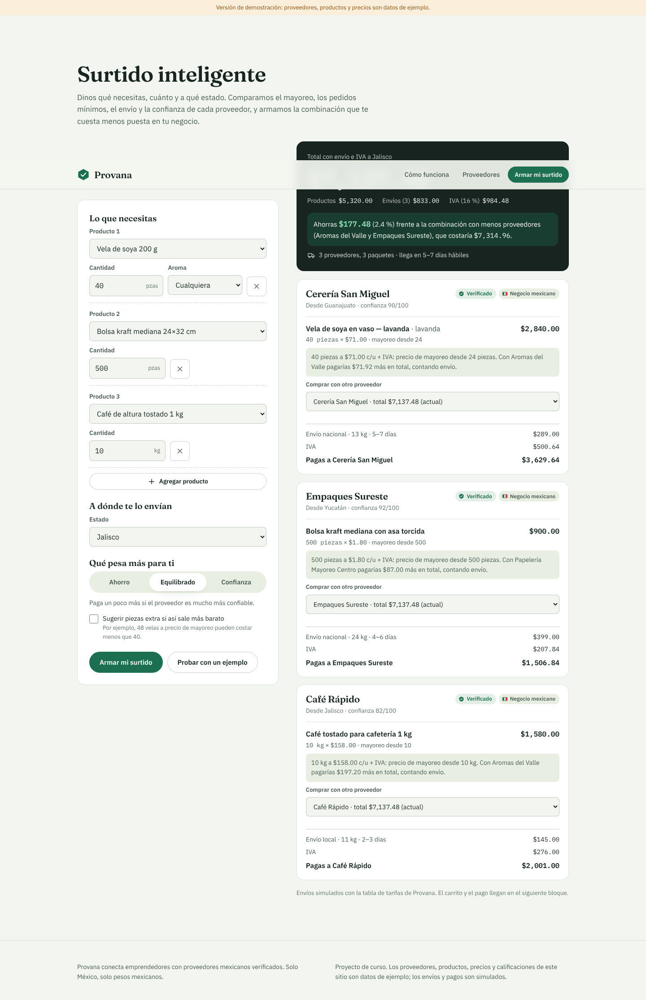
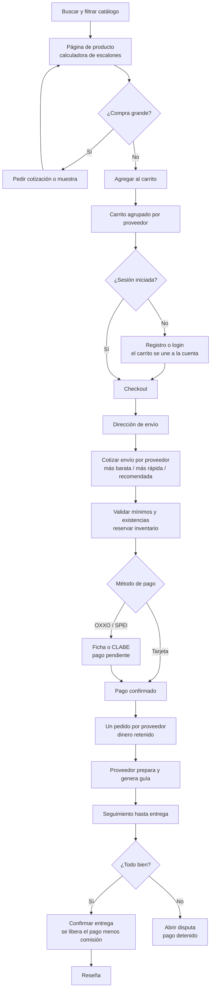
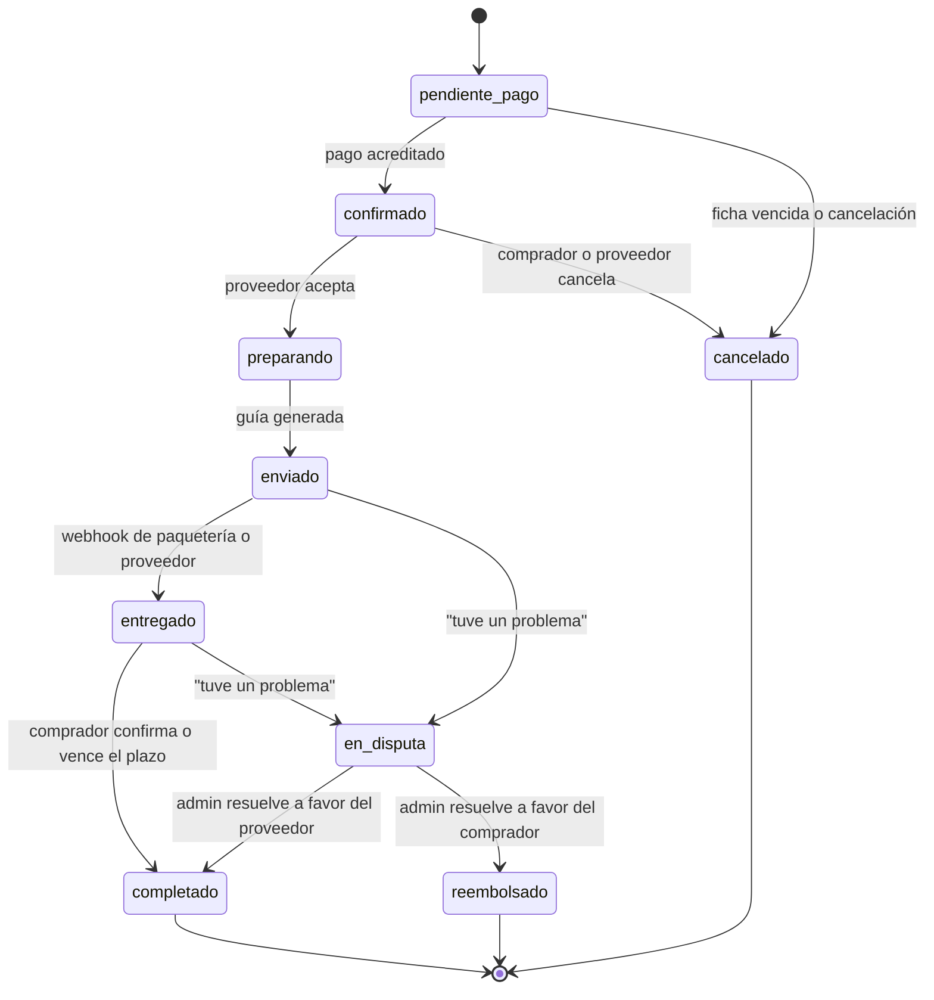
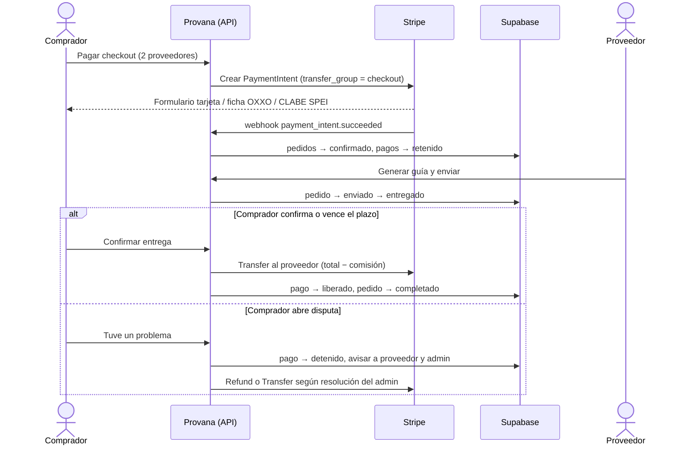
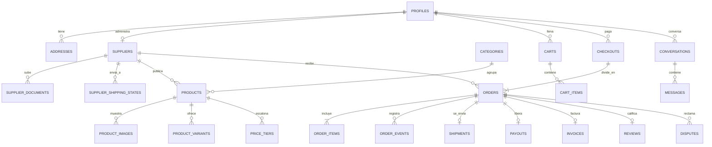

# Provana

Marketplace mexicano que conecta emprendedores con proveedores confiables. No es un directorio: cada proveedor tiene su tienda con productos, precios de menudeo y mayoreo, existencias y condiciones. El comprador busca, compara, verifica, compra, elige envío y recibe, con el pago retenido hasta que confirma la entrega.

> **Función estrella: [Surtido inteligente](docs/surtido-inteligente.md).** Escribes qué necesitas y a qué estado; Provana arma la combinación de proveedores más barata y confiable, te explica cada elección y te dice cuánto ahorras.
>
> **Modo demostración.** Pagos y envíos simulados; los proveedores y productos son datos de ejemplo; las cuentas y los pedidos se guardan en tu navegador. Ver [Qué es real y qué es simulado](#qué-es-real-y-qué-es-simulado).

- **Alcance:** solo México (32 estados), solo proveedores mexicanos, solo MXN con IVA desglosado, todo en español de México.
- **Usuarios:** comprador, proveedor y administración.
- **Plataforma:** web responsiva, celular primero, instalable como app (PWA).



## Cómo probarla en 2 minutos

1. Abre la app y entra a **Entrar** → *Cuentas de demostración* (contraseña de todas: `provana123`).
2. **Comprador** (`comprador@demo.provana.mx`): arma tu surtido, compara, compra a dos proveedores con la tarjeta de prueba `4242 4242 4242 4242`.
3. **Proveedor** (`proveedor@demo.provana.mx`, tienda Aromas del Valle): en **Panel → Pedidos** prepara, genera la guía y simula la entrega. Cada proveedor de ejemplo tiene cuenta: `<id>@demo.provana.mx` (por ejemplo `finca-los-cerros@demo.provana.mx`).
4. **Comprador**: confirma la entrega (se libera el pago menos la comisión), deja una reseña, o usa “Tuve un problema” para abrir una disputa.
5. **Administración** (`admin@demo.provana.mx`): verifica proveedores nuevos, resuelve disputas, modera reseñas, cambia la comisión y adelanta el reloj para probar la liberación automática a los 5 días. **Reiniciar demostración** borra todo y vuelve a los datos de ejemplo.

## Funcionalidades

| Bloque | Qué hay | Prueba automática |
|---|---|---|
| ★ Surtido inteligente | Lista de productos y cantidades, prioridad Ahorro/Equilibrado/Confianza, comparación del ahorro, explicación por proveedor, cambiar proveedor, agregar todo al carrito | `src/lib/surtido/__tests__` (criterios 1–11), `e2e/surtido.spec.ts` (criterio 12) |
| Cuentas y roles | Registro de comprador y proveedor, entrar, recuperar contraseña con código, confirmar correo, direcciones, permisos revisados en cada acción de la capa de datos | `src/lib/tienda/__tests__/flujo.test.ts`, `e2e/flujo-completo.spec.ts` |
| Verificación | RFC, identificación, comprobante de domicilio, fotos del taller; estados en revisión / verificado / rechazado con motivo; solo verificados aparecen | idem |
| Catálogo | Búsqueda sin acentos, filtros (categoría, estado del proveedor, envía a mi estado, precio, calificación, mínimo, días de entrega), 6 órdenes, favoritos, comparador de 3 con barra flotante, mapa por estado | `e2e/flujo-completo.spec.ts` |
| Producto | Escalones con calculadora en vivo y barra hacia el siguiente escalón, variantes, envío estimado por estado, permisos sanitarios con insignia, cotización y muestra, confianza con desglose, datos estructurados de producto | idem |
| Carrito | Persistente (también sin sesión, se une al entrar), agrupado por proveedor, mínimos y existencias, listas recurrentes, volver a pedir | `flujo.test.ts` |
| Pago (simulado) | Tarjeta de prueba, ficha de tienda de conveniencia, SPEI; rechaza tarjetas reales; pago retenido → liberado menos 8 % de comisión → detenido si hay disputa; CFDI solicitado y subido por el proveedor | `tienda.test.ts`, `flujo.test.ts` |
| Envíos (simulados) | Estándar, Exprés y Sucursal por proveedor, con más barata / más rápida / recomendada, peso volumétrico, zona extendida, perecederos, guía | `tienda.test.ts` |
| Pedidos | Línea de tiempo que se dibuja con palomita, cancelación antes de “preparando”, confirmar entrega, liberación automática a los 5 días | `tienda.test.ts`, `flujo.test.ts` |
| Confianza | Reseñas solo de compras completadas (con fotos y respuesta), reportes, disputas con historial y reembolso parcial, chat | idem |
| Panel del proveedor | Resumen con gráfica de 6 meses explicada, alertas de inventario, productos (crear/editar/pausar/borrar, carga CSV con reporte por fila), pedidos, cotizaciones, mensajes, estado de cuenta, cupones, datos de la tienda, verificación | `e2e/flujo-completo.spec.ts` |
| Administración | Métricas, verificaciones, disputas, reseñas reportadas, pedidos, comisión y reglas configurables, plan destacado (espacio), reloj simulado, reiniciar demo | idem |
| Avisos | Bandeja de correos simulados por evento, preferencias por tipo, alertas de bajada de precio y reposición | `flujo.test.ts` |
| Legal y calidad | Términos, privacidad, envíos, devoluciones y antifraude (texto base para revisión legal), contraste AA verificado, axe sin violaciones graves, movimiento reducido, PWA, SEO | `contraste.test.ts`, `e2e/accesibilidad.spec.ts` |

## Qué es real y qué es simulado

| Real | Simulado (modo demostración) |
|---|---|
| Motor del surtido, precios por escalón, IVA, comisión, flujo de estados, validaciones, permisos por rol en la capa de datos | **Pagos**: no se cobra nada; capa intercambiable en `src/lib/tienda/pagos.ts` |
| Búsqueda, filtros, carrito, pedidos, reseñas, disputas, chat, paneles | **Envíos y guías**: tabla de tarifas en `src/data/tarifas.json` |
| Pruebas automáticas (unitarias, navegador, accesibilidad) | **Correos**: bandeja de avisos dentro de la app |
| | **Datos**: guardados en el navegador (`src/lib/tienda/almacen.ts`); cada navegador tiene su propia tienda |
| | **Archivos** (documentos, facturas): se guarda el nombre; las fotos se guardan reducidas |

## Cómo correrlo

Requiere Node.js 22 o más reciente.

```bash
npm install
```

```bash
npm run dev
```

Abre http://localhost:3000. No necesita llaves ni base de datos.

| Comando | Qué hace |
|---|---|
| `npm test` | 114 pruebas unitarias (Vitest) |
| `npm run build` | Compila para producción |
| `npm run test:e2e` | Pruebas en navegador (Playwright) en celular y escritorio, incluidas axe y movimiento reducido; compila antes |
| `npm run esquemas` | Regenera `esquemas/*.schema.json` |

### Desplegar en Vercel

1. En vercel.com → **Add New… → Project** → importa `Monsxa/Provana`.
2. Sin variables obligatorias. Opcional: `NEXT_PUBLIC_SITE_URL` cuando tengas dominio propio.
3. **Deploy**.

## Estructura

```
src/
  app/                 páginas (App Router) y API
    surtido/           Surtido inteligente
    catalogo/ producto/ comparar/ carrito/ checkout/ pedidos/   compra
    entrar/ cuenta/ avisos/ mensajes/                            cuenta
    panel/             panel del proveedor
    admin/             administración
    proveedores/       mapa por estado y fichas
    legal/             términos, privacidad, envíos, devoluciones, antifraude
    api/surtido/       POST /api/surtido
  components/          movimiento, búsqueda ⌘K, anillo de confianza, piezas de tienda
  data/                datos de ejemplo en JSON validados con esquema
  lib/
    surtido/           motor del surtido (+ pruebas)
    tienda/            capa de datos demo, pedidos, pagos, envíos, CP, CSV, permisos (+ pruebas)
e2e/                   pruebas en navegador
docs/                  especificaciones, API, wireframes, esquema de datos, capturas, Lighthouse
```

## Documentos

| Archivo | Qué contiene |
|---|---|
| [`BITACORA.md`](BITACORA.md) | Decisiones de negocio: qué propuso Claude, qué decidió Monse, cómo se probó, qué falló |
| [`PROMPT_LOG.md`](PROMPT_LOG.md) | Decisiones del trabajo visual y de movimiento |
| [`docs/especificaciones.md`](docs/especificaciones.md) | Pasos y criterios de aceptación por funcionalidad, y los algoritmos |
| [`docs/surtido-inteligente.md`](docs/surtido-inteligente.md) | Algoritmo del surtido, fórmula del riesgo, ejemplo trabajado |
| [`docs/api.md`](docs/api.md) | Endpoint HTTP y funciones de la capa de datos |
| [`docs/wireframes.md`](docs/wireframes.md) · [`docs/esquema-datos.md`](docs/esquema-datos.md) | Planeación |
| [`docs/capturas/`](docs/capturas) · [`docs/lighthouse/`](docs/lighthouse) | Capturas (escritorio, celular, oscuro) e informes de Lighthouse |

## Stack

| Pieza | Qué se usa | Por qué |
|---|---|---|
| App | Next.js 15 (App Router) + TypeScript | Páginas pre-generadas para productos y proveedores (SEO), API en el mismo proyecto |
| Datos | Capa de datos en el navegador detrás de funciones de negocio | Funciona sin llaves; se reemplaza por Supabase sin cambiar las pantallas |
| Validación | Zod → JSON Schema | Un esquema valida y documenta |
| Diseño | Tokens verdes 50–900, Fraunces + IBM Plex autoalojadas, íconos Lucide | Identidad de la landing original, contraste AA verificado |
| Pruebas | Vitest, Playwright, axe-core, Lighthouse | Lógica, flujo real en navegador, accesibilidad y rendimiento |

## Diagramas

### Flujo de compra



### Estados del pedido



`pendiente_pago`, `en_disputa` y `reembolsado` son estados que agrego a los que pediste; están marcados como propuesta en la bitácora.

### Pagos retenidos (hoy simulados; así funcionaría con Stripe Connect)



### Esquema de datos para Supabase (resumen; la demo usa la misma forma en el navegador)



El detalle de cada tabla, columnas y políticas de seguridad está en [`docs/esquema-datos.md`](docs/esquema-datos.md).

## Pendiente para producción

- **Supabase** (base de datos, cuentas, archivos privados, RLS): las reglas de `src/lib/tienda/permisos.ts` pasan a políticas por fila. Necesita el proyecto de Monse.
- **Entrar con Google**: necesita un cliente OAuth de Google Cloud.
- **Pagos reales** (Stripe Connect o Mercado Pago) y **envíos reales** (Envía.com): implementar `ProveedorPagos` y una cotización real. Revisión legal de la retención de fondos (Ley Fintech).
- **Correo real** (Resend con dominio propio) y **WhatsApp Cloud API**.
- **Carga desde Excel nativo**: hoy se acepta CSV (Excel → “CSV UTF-8”).
- **Rendimiento del catálogo y la ficha de producto**: Lighthouse en celular da 82 y 85 (portada 97, surtido 99, proveedor 95). Esas páginas dependen del JavaScript de la tienda en el navegador; al conectar Supabase se pueden pre-renderizar en el servidor.
