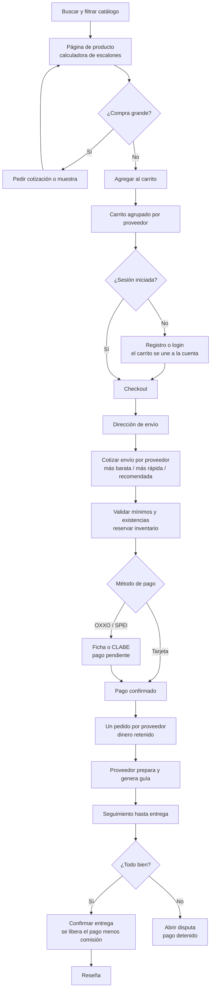
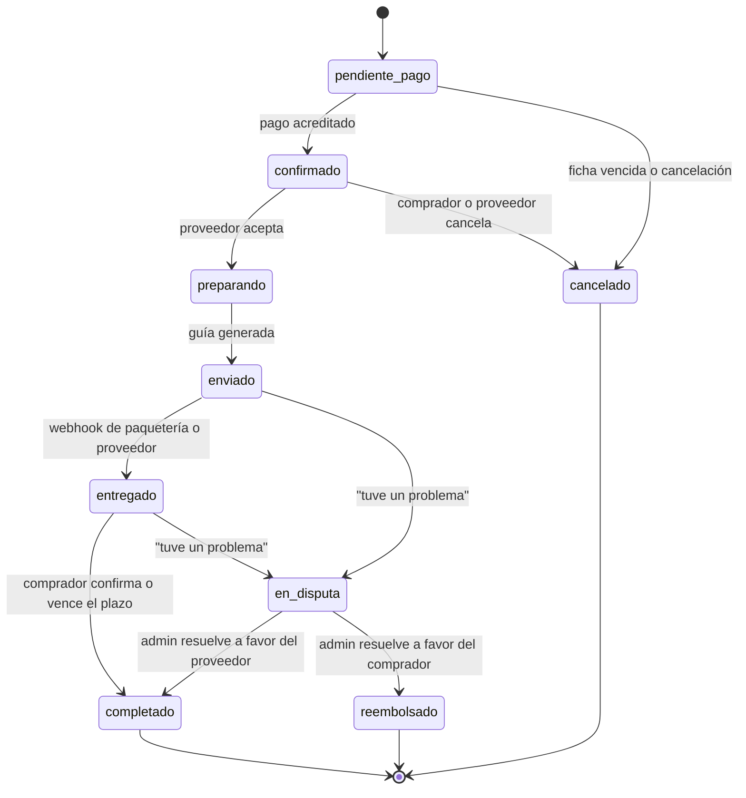
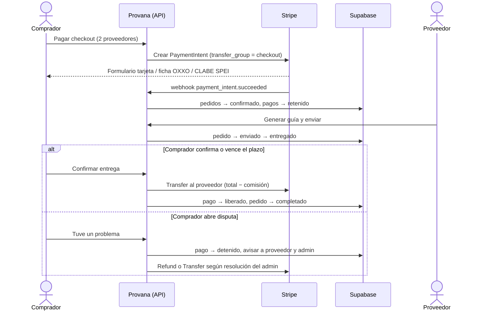
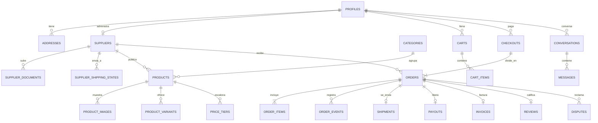

# Provana

Marketplace mexicano que conecta emprendedores con proveedores confiables. No es un directorio: cada proveedor tiene su tienda con productos, precios de menudeo y mayoreo, existencias y condiciones de compra. El comprador busca, compara, verifica, compra, elige envío y recibe, todo dentro de Provana, con el pago retenido hasta que confirma la entrega.

> **Función estrella: [Surtido inteligente](docs/surtido-inteligente.md)** — arma la mejor combinación de proveedores para tu lista.
>
> **Estado actual: planeación.** Este documento contiene la propuesta de stack, los diagramas y el esquema de datos. Todavía no hay código de la aplicación; la landing original sigue en `index.html`. Las decisiones pendientes están en [`BITACORA.md`](BITACORA.md).

- **Alcance:** solo México (32 estados), solo proveedores mexicanos, solo MXN con IVA desglosado, todo en español de México.
- **Usuarios:** comprador, proveedor y administrador.
- **Plataforma:** web responsiva pensada primero para celular, instalable como app (PWA).

## Documentos

| Archivo | Qué contiene |
|---|---|
| [`BITACORA.md`](BITACORA.md) | Una entrada por decisión: qué propuse, qué decidiste, por qué, cómo se probó, qué falló |
| [`docs/wireframes.md`](docs/wireframes.md) | Wireframes de las pantallas principales (celular primero) |
| [`docs/esquema-datos.md`](docs/esquema-datos.md) | Tablas, relaciones y políticas de seguridad por fila |
| `docs/especificaciones.md` | Se crea antes de cada funcionalidad: pasos y criterios de aceptación verificables |
| `docs/api.md` | Se crea con el código: cada endpoint con ruta, método, entrada y salida |

## Stack propuesto (pendiente de tu aprobación)

| Pieza | Propuesta | Por qué | Desventaja |
|---|---|---|---|
| App web | **Next.js (App Router) + TypeScript** | Páginas renderizadas en servidor (SEO de productos), API en el mismo proyecto, PWA posible | Curva de aprendizaje de Server Components |
| Base de datos, cuentas y archivos | **Supabase** (Postgres + Auth + Storage + Realtime) | Políticas de seguridad por fila (RLS) reales en la base, Google login, archivos privados, chat en tiempo real, plan gratuito | El plan gratuito pausa proyectos inactivos 7 días |
| Despliegue | **Vercel** | Se integra con GitHub (vista previa por cada PR), variables de entorno por ambiente | Límites del plan Hobby (uso no comercial) |
| Pagos | **Simulados** (decisión de Monse, entrada 1 de la bitácora) detrás de una interfaz `PaymentProvider` intercambiable | Flujo completo (tarjeta de prueba, OXXO, SPEI, pago retenido, liberación) sin cobrar nada ni pedir tarjetas reales | Para cobrar de verdad hay que implementar un proveedor real (Stripe Connect o Mercado Pago) con la misma interfaz |
| Envíos | **Envía.com API** (sandbox) | Cotiza varias paqueterías en una llamada, genera guías, webhooks de rastreo | Hay que fondear saldo para guías reales en producción |
| Correo | **Resend** + plantillas React Email | API simple, plan gratuito (3,000 correos/mes) | Requiere verificar un dominio propio para enviar a cualquier destinatario |
| WhatsApp | **WhatsApp Cloud API (Meta)**, solo dejado listo | Oficial y sin intermediarios | Requiere cuenta de Meta Business verificada y plantillas aprobadas |
| Búsqueda | Postgres `unaccent` + `pg_trgm` | Tolerancia a acentos y errores sin servicio externo | Menos potente que Algolia en catálogos enormes |
| Validación | **Zod** → JSON Schema | Un solo esquema valida en servidor y genera el JSON Schema documentado | — |
| Pruebas | **Vitest** (unitarias) + **Playwright** (flujos completos) | Rápidas; Playwright recorre la app real en el navegador | — |
| Límite de peticiones | Upstash Redis (o tabla en Postgres) | Protección contra abuso en registro, login y API | Un servicio más si usamos Upstash |

**Si algún día se conectan pagos reales — alternativas evaluadas:** Stripe Connect (retención y liberación controladas por la plataforma),  Mercado Pago Marketplace (muy conocido en México, OXXO y meses sin intereses, pero el control de cuándo se libera el dinero lo maneja Mercado Pago, no la plataforma) y Conekta (mexicano, buen OXXO/SPEI, pero sin un producto de marketplace con split y retención tan completo).

**Aviso legal:** retener dinero de terceros en México puede tocar la Ley Fintech. Usar el producto de marketplace de un procesador autorizado (Stripe, Mercado Pago) reduce el riesgo porque el procesador custodia los fondos, pero esto debe revisarlo un abogado antes de pasar a producción.

## Diagramas

### Flujo de compra

### Estados del pedido

`pendiente_pago`, `en_disputa` y `reembolsado` son estados que agrego a los que pediste; están marcados como propuesta en la bitácora.

### Pagos retenidos (Stripe Connect)

### Esquema de datos (resumen)

El detalle de cada tabla, columnas y políticas de seguridad está en [`docs/esquema-datos.md`](docs/esquema-datos.md).

## Algoritmos clave (borrador)

**Precio por cantidad.** Dado `cantidad` y los escalones ordenados por `cantidad_minima` ascendente, el precio unitario es el del escalón más alto cuya `cantidad_minima ≤ cantidad`; si ninguno aplica, es el precio de menudeo. Validación al guardar: cada escalón tiene mayor cantidad mínima y menor precio que el anterior, y el primero es más barato que el menudeo. "Te faltan N piezas para el siguiente escalón" = `siguiente.cantidad_minima − cantidad`. Todo en centavos (enteros) para evitar errores de redondeo.

**Calificación del proveedor.** Promedio bayesiano para que 2 reseñas de 5★ no ganen a 300 de 4.8★: `(C·m + Σ estrellas) / (C + n)`, con `m` = promedio de la plataforma y `C` = 10 reseñas de peso. Se muestra también el promedio simple y el número de reseñas.

**Envío.** Peso facturable por paquete = `max(peso real, largo×ancho×alto / 5000)`; se cotiza con Envía.com desde el estado de origen del proveedor al código postal del comprador; si el proveedor no envía a ese estado, no se ofrece. Marcas: más barata (mínimo costo), más rápida (mínima fecha de llegada), recomendada (mejor puntaje combinado de costo y tiempo).

## Estado de funcionalidades

| # | Bloque | Estado |
|---|---|---|
| 0 | Planeación, stack, wireframes, diagramas | ✅ propuesta lista, esperando respuestas |
| 1 | Base y cuentas | ⏳ |
| 2 | Verificación y administración | ⏳ |
| 3 | Tienda y catálogo | ⏳ |
| 4 | Carrito | ⏳ |
| 5 | Pagos (sandbox) | ⏳ |
| 6 | Logística (sandbox) | ⏳ |
| 7 | Pedidos, reseñas, disputas, chat | ⏳ |
| 8 | Panel del proveedor | ⏳ |
| 9 | Avisos | ⏳ |
| 10 | Legal y calidad | ⏳ |

## Cómo correrlo

Se documenta en cuanto exista el proyecto de Next.js (bloque 1).
